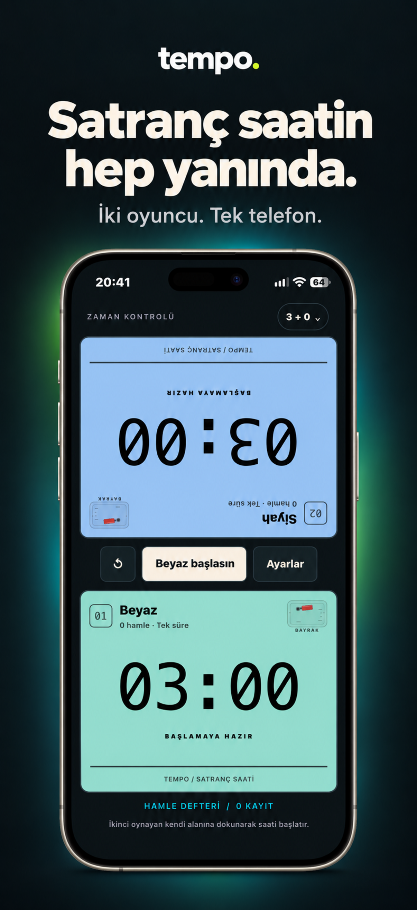
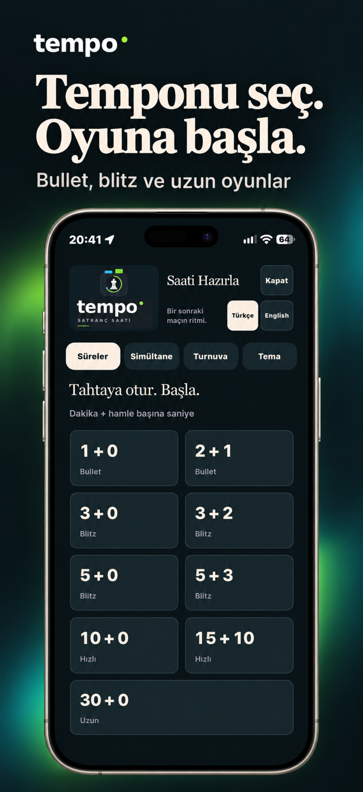
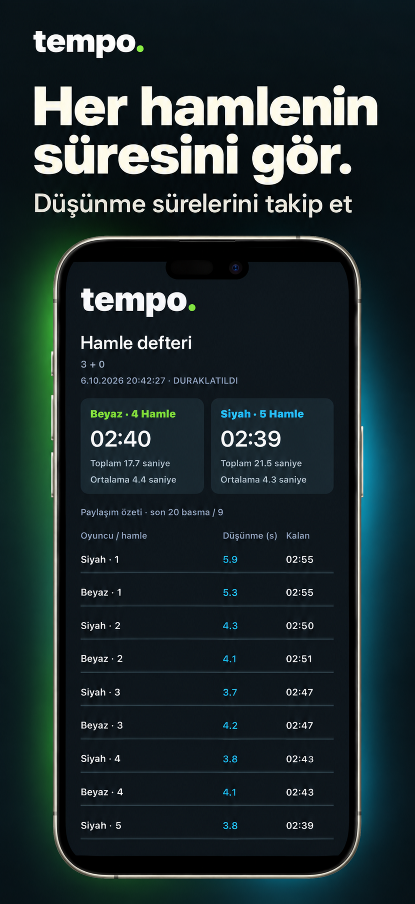
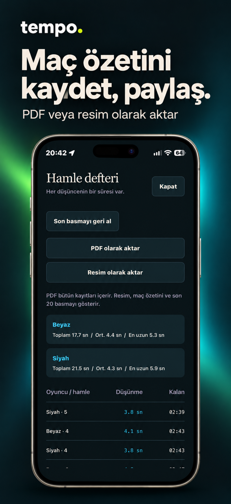
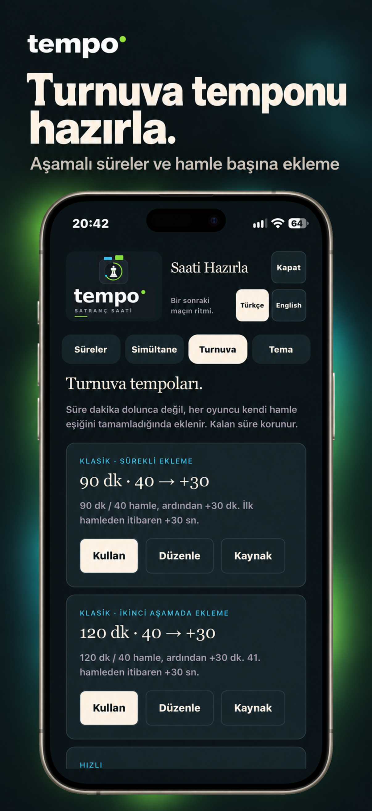
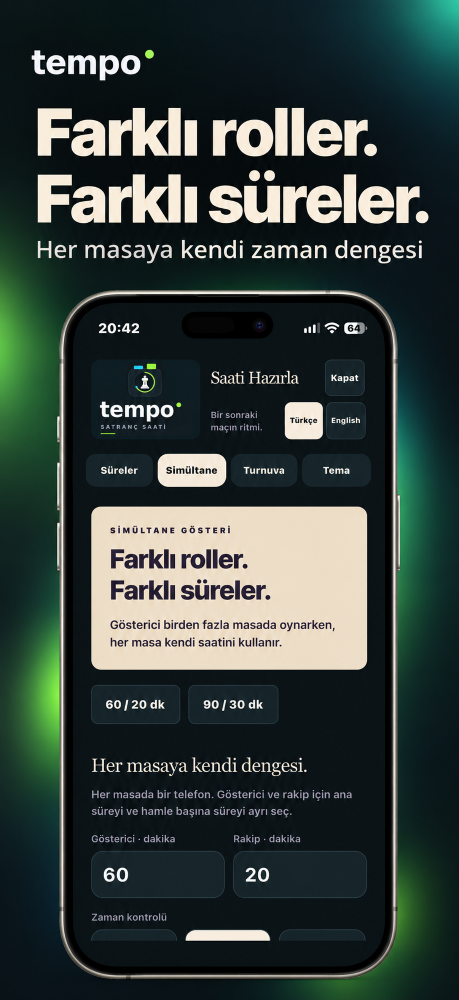
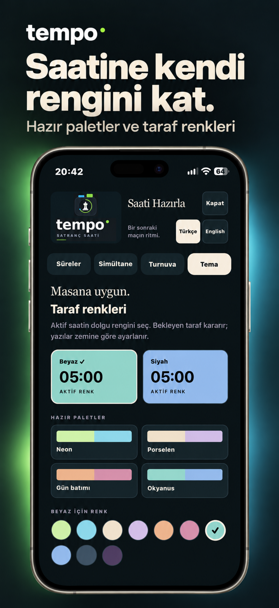
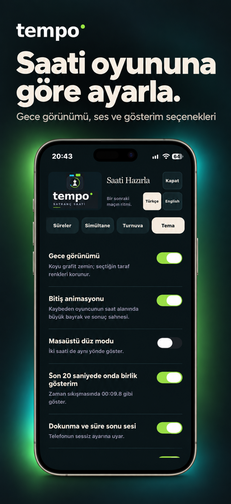

# ⏱️ Tempo – Animated Chess Clock
### **Mekanik Bayrak Animasyonlu, Gelişmiş Zaman Kontrollü, Hamle Kayıtlı ve Raporlama Destekli Profesyonel Satranç Saati (React Native + Expo SDK 57 + TypeScript + Cross-Platform UI)**

---

## 🚀 Proje Hakkında

**Tempo**, yüz yüze satranç müsabakaları, antrenmanlar ve turnuva organizasyonları için geliştirilmiş; analog mekanik satranç saatlerinin nostaljik hissini dijital dünyanın hassasiyetiyle birleştiren modern, iki dilli (Türkçe & English) bir **React Native (Expo)** satranç saati uygulamasıdır.

Sıradan dijital satranç saatlerinden farklı olarak **Tempo**; gerçek fizik kurallarına göre salınan ve düşen **mekanik bayrak (flag fall) animasyonu**, maç anında heyecanla yanlış dokunmaları engelleyen **çift dokunuşlu kaza koruma sistemi**, hamle hamle süre kullanımını kaydeden **hamle defteri** ve maç bitiminde oluşturulan **vektörel PDF / fotoğraf maç raporu kartı** ile benzersiz bir deneyim sunar.

---

## 📌 İçindekiler
- [Temel Özellikler](#-temel-özellikler)
- [Öne Çıkan İnovatif Modüller](#-öne-çıkan-inovatif-modüller)
- [Desteklenen Zaman Kontrolleri](#-desteklenen-zaman-kontrolleri)
- [Kullanılan Teknolojiler](#-kullanılan-teknolojiler)
- [Ekran Görüntüleri](#-ekran-görüntüleri)
- [Proje Dizin Yapısı](#-proje-dizin-yapısı)
- [Kurulum ve Çalıştırma](#-kurulum-ve-çalıştırma)
- [Test ve Doğrulama](#-test-ve-doğrulama)
- [Gizlilik ve Güvenlik](#-gizlilik-ve-güvenlik)
- [Geliştirici ve İletişim](#-geliştirici-ve-iletişim)

---

## ✨ Temel Özellikler

- 🚩 **Gerçekçi Mekanik Bayrak Animasyonu:** Analog saatlerin efsanevi bayrak mekanizması; süre son 30 saniyeye girdiğinde yükselir, sıfırlandığı anda düşerek görsel ve işitsel bir final sunar.
- ⏱️ **Kapsamlı Zaman Kontrolleri:** Fischer (Artırmalı), Bronstein (Gecikmeli), Basit Gecikme (Simple Delay), Standart Süre ve Özel Kademeli Turnuva tempoları.
- 🛡️ **Kaza Önleyici Çift Dokunuş Koruması:** Maç devam ederken heyecanla ortadaki duraklatma veya sıfırlama butonlarına yanlışlıkla dokunulmasını önleyen iki kademeli onay güvenliği.
- 📝 **Hamle Defteri (Move History):** Her oyuncunun her hamlede ne kadar süre harcadığını milisaniye hassasiyetinde tutan kronometrik kayıt sistemi.
- 📄 **Maç Özeti & PDF / Fotoğraf Raporu:** Maç sonunda oyuncuların toplam süreleri, hamle başı ortalama düşünme süresi ve kritik anları içeren şık A4 PDF veya galeriye kaydedilebilir PNG maç kartı.
- 🤝 **Simültane Gösteri Modu:** Antrenörlerin veya ustaların aynı anda birden fazla masayı tek ekrandan yönetebilmesini sağlayan özel simültane paneli.
- 🎨 **Özelleştirilebilir Temalar ve Sesler:** Ahşap, gece modu, klasik satranç saati, modern neon renk paletleri ve gerçekçi mekanik saat tıklama sesleri.
- 📱 **Cross-Platform & Cihaz Optimizasyonları:** iPhone, iPad ve Android cihazlarda tam ekran, Keep-Awake (ekranın kararmasını önleme) ve titreşim (Haptic Feedback) desteği.

---

## 🧠 Öne Çıkan İnovatif Modüller

### 1. Mekanik Bayrak Motoru (`MechanicalFlag.tsx` & `FlagFinale.tsx`)
Zaman azaldığında oyuncunun bayrağı yavaşça kalkar. Süre bittiğinde bayrak yerçekimi etkisiyle sertçe düşer; titreşim ve ses efekti eşliğinde oyuncunun süresinin bittiği net bir şekilde ilan edilir.

### 2. Akıllı Kontrol Güvenliği (`control-confirmation.mjs`)
Hızlı satrançta (Bullet/Blitz) oyuncuların saat düğmesine basarken yanlışlıkla ekranın ortasındaki "Sıfırla" veya "Duraklat" butonlarına dokunması maçı mahvedebilir. Tempo, saat akarken kritik butonları **çift hızlı dokunuş (double-tap)** şartına bağlar. Saat durduğunda ise tek dokunuşla menüye dönülebilir.

### 3. Hamle Süresi Analizi & PDF Raporu (`report.mjs` & `ReportCard.tsx`)
Maç boyunca yapılan her basış kaydedilir. Kim hangi hamlede ne kadar düşündü? Maç sonunda tek dokunuşla A4 formatında maç analiz raporu üretilir veya Instagram Story boyutunda görsel olarak dışa aktarılır.

---

## ⌛ Desteklenen Zaman Kontrolleri

| Kategori | Popüler Ön Tanımlar | Açıklama |
| :--- | :--- | :--- |
| **Bullet** | `1+0`, `1+1`, `2+1` | Yıldırım hızında refleks satrancı |
| **Blitz** | `3+0`, `3+2`, `5+0`, `5+3` | Standart kulüp ve turnuva yıldırım temposu |
| **Rapid** | `10+0`, `10+5`, `15+10` | Hızlı satranç şampiyonaları |
| **Classic** | `30+0`, `60+30`, `90+30` | Uzun düşünme sürelerine sahip resmî turlar |
| **Özel (Custom)** | Kullanıcı tanımlı | İstenilen dakika, saniye ve hamle artırımı |

---

## ⚙️ Kullanılan Teknolojiler

<p align="center">
  
  
  
  
  
  
  
  
</p>

---

## 📸 Ekran Görüntüleri

| **01. Saat & Mekanik Bayrak** | **02. Süre & Tempo Seçimi** | **03. Hamle Süreleri Defteri** |
| :---: | :---: | :---: |
|  |  |  |

<br>

| **04. Maç Özeti & Rapor Paylaşımı** | **05. Turnuva Modu** | **06. Simültane Gösteri Modu** |
| :---: | :---: | :---: |
|  |  |  |

<br>

| **07. Renk & Tema Seçici** | **08. Kapsamlı Ayarlar** |
| :---: | :---: |
|  |  |

---

## 📁 Proje Dizin Yapısı

```bash
tempo-chess-clock/
├── assets/                     # İkonlar, mekanik ses dosyaları ve grafikler
├── docs/                       # Mağaza metinleri, yönergeler ve ekran görüntüleri
│   ├── screenshots/            # README ve App Store yüksek çözünürlüklü görselleri
│   └── GITHUB-YUKLEME.md       # Dağıtım ve GitHub yükleme rehberi
├── locales/                    # Türkçe ve İngilizce yerelleştirme JSON dosyaları
├── scripts/                    # SHA-256 doğrulama, sürüm kontrol ve APK derleme araçları
├── src/                        # Uygulama mantığı ve bileşenleri
│   ├── clock.mjs               # Milisaniye hassasiyetli saat algoritması
│   ├── control-confirmation.mjs# Çift dokunuş güvenlik motoru
│   ├── MechanicalFlag.tsx      # Fizik tabanlı bayrak animasyonu bileşeni
│   ├── FlagFinale.tsx          # Zaman dolum efekti ve modalı
│   ├── report.mjs              # PDF ve PNG maç raporu oluşturucu
│   └── ThemePicker.tsx         # Renk ve tema yöneticisi
├── store/                      # TestFlight & App Store meta verileri
├── tests/                      # Zaman hesaplama ve çift dokunuş birim testleri
├── App.tsx                     # Ana saat arayüzü ve sahne yönetimi
├── Android-APK-Windows.bat     # Windows için doğrudan APK derleme betiği
└── package.json                # Paket yapılandırması ve betikler
```

---

## 📥 Kurulum ve Çalıştırma

### Gereksinimler
- **Node.js:** `v20.0.0` veya üzeri
- **npm:** `v9.0.0` veya üzeri

### 1. Repoyu Klonlayın
```bash
git clone https://github.com/Cevdet-Karakulak/tempo-chess-clock.git
cd tempo-chess-clock
```

### 2. Bağımlılıkları Yükleyin
```bash
npm ci
```

### 3. Uygulamayı Başlatın

#### 📱 Mobil (Expo):
```bash
npm start
```
Terminaldeki QR kodu **Expo Go** uygulaması ile taratarak doğrudan telefonunuzda çalıştırın.

#### 🌐 Web Önizleme:
```bash
npm run web
```

#### 🤖 Android APK Derleme:
Windows ortamında tek tıklamayla APK üretmek için:
```bash
Android-APK-Windows.bat
```

---

## 🧪 Test ve Doğrulama

Uygulamanın zamanlama hassasiyeti ve derleme bütünlüğü sıkı testlerle korunur:

```bash
# Zamanlayıcı ve mantık testleri
npm test

# TypeScript tip kontrolü
npm run check

# Yayın ve SHA-256 bütünlük kontrolü
npm run release:check
```

---

## 🔒 Gizlilik ve Güvenlik

- **Tamamen Çevrimdışı (Offline-Only):** İnternet bağlantısı gerektirmez; hiçbir kullanıcı verisi veya maç süresi sunuculara iletilmez.
- **Sıfır İzin İhlali:** Arka planda ses kaydı veya mikrofon izni istemez (B1 Audio standartlarına tam uyumludur).
- **Reklamsız & Ücretsiz:** Saf satranç deneyimi için tasarlanmıştır.

---

## 👨‍💻 Geliştirici ve İletişim

**Cevdet Karakulak**  
*Junior Full Stack Developer*

- 🌐 **GitHub:** [@Cevdet-Karakulak](https://github.com/Cevdet-Karakulak)
- 💼 **Projeler:** [NexDrop](https://github.com/Cevdet-Karakulak/NexDrop) • [UKD Hesapla](https://github.com/Cevdet-Karakulak/ukd-hesapla) • [Tempo](https://github.com/Cevdet-Karakulak/tempo-chess-clock)
- 📧 **Destek & Geri Bildirim:** `floppatechcorp@gmail.com`

---

<p align="center">
  <sub>Zamanınızı iyi kullanın, şahınızı koruyun. ♟️⏱️</sub>
</p>
